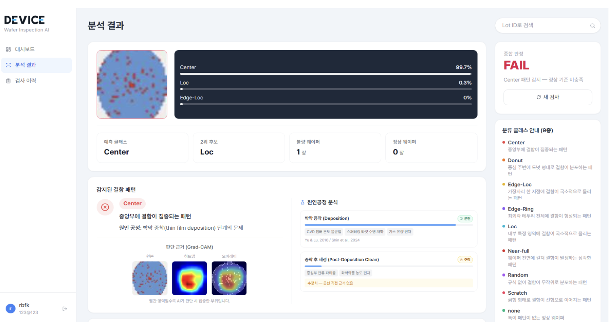
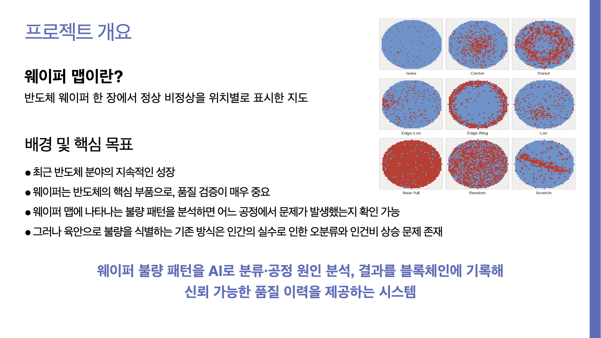
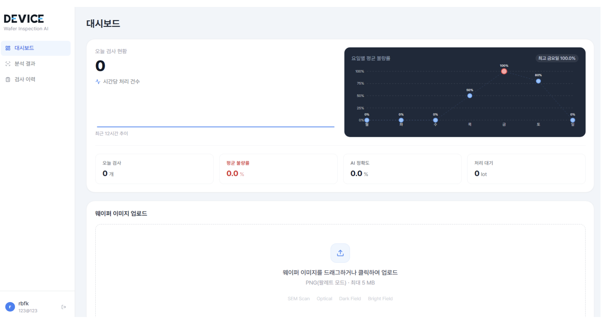
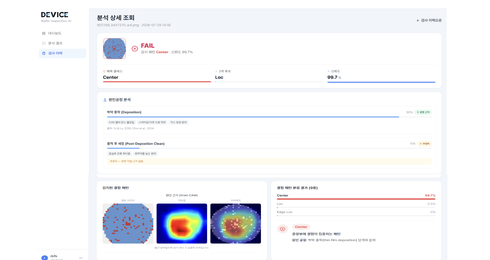
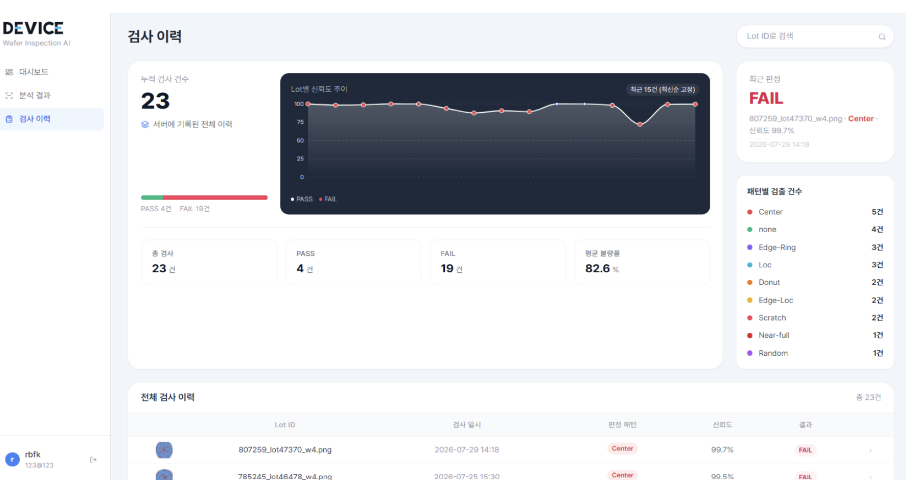
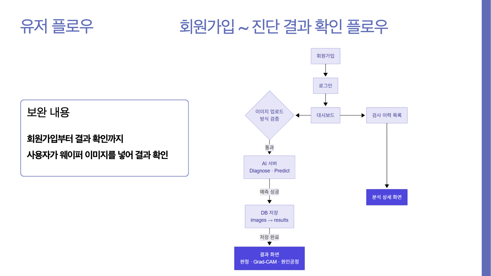
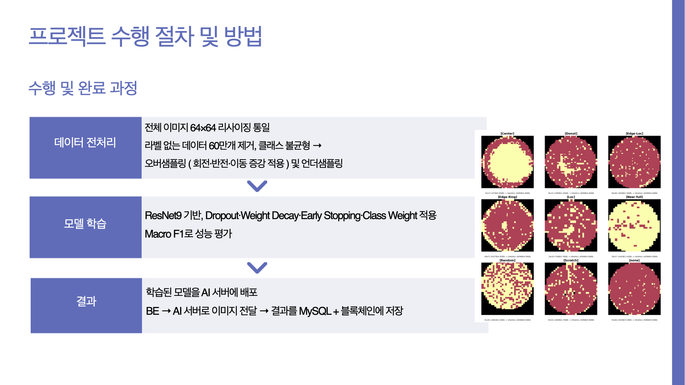
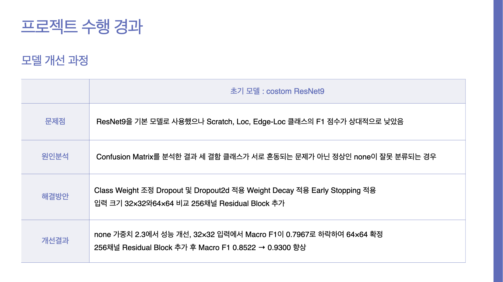
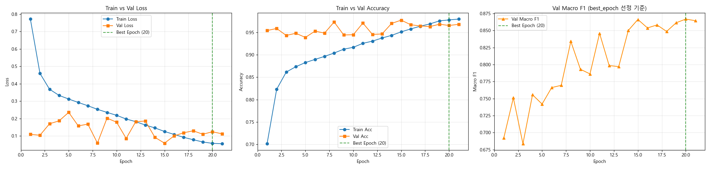
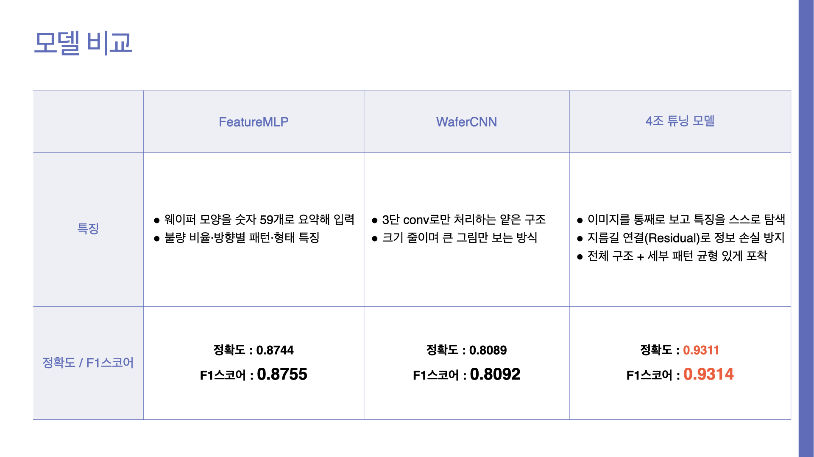

# AX Project — 웨이퍼 불량 AI 분석 시스템

> **작은 결함까지 놓치지 않는 AI 품질 검사** · K-디지털 트레이닝 4기 · AX 프로젝트 4조

반도체 웨이퍼 맵 이미지를 업로드하면 ResNet9 딥러닝 모델이 결함 패턴을 분류하고, Grad-CAM 판단 근거와 원인 공정 후보까지 대시보드와 이력으로 제공하는 풀스택 웹 애플리케이션입니다.



## 프로젝트 개요

- 웨이퍼 맵의 불량 패턴을 분석하면 **어느 공정에서 문제가 발생했는지** 추적할 수 있지만, 육안 판독은 오분류와 인건비 상승 문제가 있습니다.
- 웨이퍼 불량 패턴을 AI로 분류하고 공정 원인을 분석해, 신뢰할 수 있는 품질 이력을 제공하는 것이 목표입니다.
- 데이터셋: **WM-811K** (정상 1종 + 결함 8종 = 9클래스)



## 팀 구성

| 이름 | 역할 |
|------|------|
| 박현승 (팀장) | AI 모델 설계 · 데이터 학습 |
| 김상윤 | 프론트엔드 · 문서화 |
| 김영웅 | 데이터 전처리 · AI 서버 설계 |
| 성광 | 백엔드 (프론트–DB 연결) |
| 추서림 | 백엔드 (AI 서버–DB 연결) |
| 최규라 | DB · 블록체인 |

## 화면 미리보기

| 대시보드 | 분석 결과 |
|:---:|:---:|
|  |  |
| **분석 상세 (Grad-CAM)** | **검사 이력** |
|  |  |

### 유저 플로우

회원가입 → 로그인 → 대시보드 → 웨이퍼 이미지 업로드 → AI 진단 → DB 저장 → 결과 확인(Grad-CAM · 원인공정)



---

## 프로젝트 구조

```
AX_Project/
├── fe/ax-app/          # React 프론트엔드 (포트 5173)
├── be/app/             # 메인 FastAPI 백엔드 (포트 8000)
│   ├── chu/            # 이미지 업로드 · AI 연동 라우터
│   └── sg/             # 분석 이력 · 통계 · 대시보드 라우터
├── bc/waper/           # MySQL 래퍼 FastAPI (포트 8002)
│   └── app/            # 유저 · 이미지 · 결과 테이블 관리
├── ai/hero/            # ResNet9 AI 추론 서버 (포트 8001)
│   └── server.py       # /predict 엔드포인트
└── ai/hs/              # 모델 학습 코드 · 가중치 · 유틸
```

---

## 기술 스택

| 영역 | 기술 |
|------|------|
| **Frontend** | React 18, Vite, Tailwind CSS, Recharts, Lucide React |
| **Backend** | FastAPI, SQLAlchemy, PyMySQL, Pydantic, httpx |
| **AI** | PyTorch (ResNet9), Pillow, NumPy |
| **DB** | MySQL 8.x (`waper` 데이터베이스, 자동 생성) |
| **실행 환경** | Anaconda (base), Python venv (bc/waper), Node.js |

---

## 서비스 아키텍처

```
브라우저 (5173)
    │
    ▼
Backend API (8000)
    │
    ├── POST /api/upload
    │       ├── AI Server (8001) 로 이미지 전송
    │       │       └── ResNet9 추론 결과 반환
    │       └── DB API (8002) 로 결과 저장
    │
    └── GET  /api/analyses/*
            └── DB API (8002) 조회
                        │
                    MySQL (3306)
                    waper DB
```

`be/app`은 `bc/waper`의 FastAPI 앱을 그대로 확장하여 동작합니다.
프론트엔드는 포트 8000만 호출하며, 8001과 8002는 백엔드가 내부적으로 사용합니다.

---

## 주요 기능

- **웨이퍼 이미지 업로드** — PNG 팔레트 모드, 최대 5MB, 다중 업로드 지원
- **AI 결함 분류** — 9가지 패턴 중 Top-3 확률과 함께 결과 반환
- **대시보드** — 오늘 검사 건수, 평균 불량률, AI 정확도, 시간대별·요일별 차트
- **검사 이력** — 전체 기록 페이지네이션 조회 및 정렬
- **분석 상세** — 패턴별 확률 분포 바 차트, 원본 이미지 표시
- **회원 관리** — 이메일 기반 회원가입 / 로그인

---

## ResNet9 모델

웨이퍼 맵(1채널 64×64)을 9클래스로 분류하는 fast.ai 스타일 ResNet9 (from scratch)입니다. 구조는 [`ai/hs/model.py`](ai/hs/model.py)에 있습니다.

```
Input (1×64×64)
 └─ stem  Conv3×3(64)
 └─ layer1 Conv(128) + MaxPool ─ ResidualBlock(128)
 └─ layer2 Conv(256) + MaxPool + Dropout2d(0.2) ─ ResidualBlock(256)
 └─ layer3 Conv(512) + MaxPool + Dropout2d(0.2) ─ ResidualBlock(512)
 └─ AdaptiveAvgPool → Dropout(0.4) → FC(9)
```

### 학습 파이프라인

| 단계 | 내용 |
|------|------|
| 전처리 | 이미지 64×64 리사이징 통일, 라벨 없는 데이터 약 60만 개 제거 |
| 불균형 처리 | 오버샘플링(회전·반전·이동 증강) + 언더샘플링 |
| 학습 | Dropout · Weight Decay · Early Stopping · Class Weight 적용 |
| 평가 | **Macro F1** 기준 (loss 기준은 정상 편향 문제로 폐기) |
| 배포 | 학습된 모델을 AI 서버(8001)에 배포, BE → AI 서버로 이미지 전달 → 결과를 MySQL + 블록체인에 저장 |



### 모델 개선 과정

초기 ResNet9은 Scratch · Loc · Edge-Loc의 F1이 낮았고, Confusion Matrix 분석 결과 결함 클래스끼리의 혼동이 아니라 **정상(none)으로 잘못 분류**되는 것이 원인이었습니다.

- Class Weight 조정 (none 가중치 조정), Dropout / Dropout2d, Weight Decay, Early Stopping 적용
- 입력 크기 32×32 vs 64×64 비교 → 32×32는 Macro F1 0.7967로 하락해 **64×64 확정**
- 256채널 Residual Block 추가 후 **Macro F1 0.8522 → 0.9300**



### 학습 곡선



### 모델 비교

| 모델 | 특징 | 정확도 | F1 |
|------|------|:---:|:---:|
| FeatureMLP | 웨이퍼 모양을 숫자 59개로 요약해 입력 | 0.8744 | 0.8755 |
| WaferCNN | 3단 conv의 얕은 구조 | 0.8089 | 0.8092 |
| **4조 튜닝 모델 (ResNet9)** | 이미지를 통째로 보고 특징 탐색, Residual 연결로 정보 손실 방지 | **0.9311** | **0.9314** |



### 판단 근거 시각화 · 원인공정 추론

- **Grad-CAM**: 마지막 conv layer의 활성화 맵으로 원본 / 히트맵 / 오버레이 이미지를 생성해 모델이 어디를 보고 판단했는지 표시
- **원인공정(Root Cause)**: 결함 패턴별로 문헌 근거 기반 원인 공정 후보와 가중치를 매핑 (`ai/hero/process_attribution.py`)

---

## 결함 클래스 (9종)

| 코드 | 클래스명 | 설명 |
|------|----------|------|
| 0 | none | 정상 (결함 없음) |
| 1 | center | 웨이퍼 중앙 집중 결함 |
| 2 | donut | 도넛형 링 패턴 결함 |
| 3 | edge-loc | 가장자리 국소 결함 |
| 4 | edge-ring | 가장자리 전체 링 결함 |
| 5 | loc | 임의 위치 국소 결함 |
| 6 | near-full | 웨이퍼 전반 결함 |
| 7 | random | 무작위 분포 결함 |
| 8 | scratch | 선형 스크래치 결함 |

---

## API 엔드포인트

### 업로드 · 분석 (be/chu)

| 메서드 | 경로 | 설명 |
|--------|------|------|
| POST | `/api/upload?user_num={n}` | 이미지 업로드 → AI 추론 → DB 저장 |

### 분석 이력 (be/sg)

| 메서드 | 경로 | 설명 |
|--------|------|------|
| GET | `/api/analyses?user_num={n}` | 분석 목록 (페이지네이션) |
| GET | `/api/analyses/{id}?user_num={n}` | 분석 상세 조회 |
| GET | `/api/analyses/dashboard?user_num={n}` | 대시보드 통계 |
| GET | `/api/analyses/statistics?user_num={n}` | 전체 통계 |
| GET | `/api/analyses/images/{image_num}` | 원본 이미지 반환 |
| PATCH | `/api/analyses/{id}?user_num={n}` | 분석 결과 수정 |
| DELETE | `/api/analyses/{id}?user_num={n}` | 분석 결과 삭제 |

### 회원 (bc/waper)

| 메서드 | 경로 | 설명 |
|--------|------|------|
| POST | `/users/signup` | 회원가입 |
| POST | `/users/login` | 로그인 |

---

## 초기 설정 (Git Pull 후)

### 1. bc/waper — 가상환경 및 환경변수

```powershell
cd bc/waper
python -m venv .venv
.venv/Scripts/pip install -r requirements.txt
```

`bc/waper/.env` 파일 생성:

```env
DB_USER=root
DB_PASS=본인_MySQL_비밀번호
DB_HOST=localhost
DB_PORT=3306
DB_NAME=waper
```

> `waper` 데이터베이스와 테이블은 서버 첫 실행 시 자동으로 생성됩니다.

### 2. be/app — 환경변수

```powershell
Copy-Item be/.env.example be/.env
```

필요 시 Anaconda base에 패키지 추가 설치:

```powershell
pip install -r be/requirements.txt
```

### 3. ai/hero — 모델 가중치 파일

아래 파일은 gitignore되어 있으므로 별도 수령 후 지정 경로에 배치합니다:

```
ai/hs/resnet9_wafer.pth
```

> 이 파일이 없으면 AI 서버가 시작 즉시 종료됩니다.

### 4. fe/ax-app — npm 패키지

```powershell
cd fe/ax-app
npm install
```

---

## 실행 방법

### VSCode (권장)

`Ctrl + Shift + B` 를 누르고 **Start All Servers** 를 선택합니다.

4개 서버가 별도 터미널에서 동시에 실행됩니다:

| 터미널 | 포트 | 역할 |
|--------|------|------|
| DB API | 8002 | MySQL 래퍼 (bc/waper) |
| AI Server | 8001 | ResNet9 추론 (ai/hero) |
| Backend | 8000 | 메인 API (be/app) |
| Frontend | 5173 | React 앱 (fe/ax-app) |

### 수동 실행

```powershell
# 1. DB API
cd bc/waper
.venv/Scripts/python -m uvicorn app.main:app --port 8002 --reload

# 2. AI 서버 (새 터미널)
$env:KMP_DUPLICATE_LIB_OK="TRUE"
cd ai/hero
C:/ProgramData/anaconda3/python.exe server.py

# 3. 백엔드 (새 터미널)
$env:PYTHONPATH="C:/절대경로/AX_Project"
cd be/app
C:/ProgramData/anaconda3/Scripts/uvicorn.exe main:app --port 8000 --reload

# 4. 프론트엔드 (새 터미널)
cd fe/ax-app
npm run dev
```

브라우저에서 `http://localhost:5173` 접속

---

## 환경변수 정리

| 파일 | 키 | 설명 |
|------|----|------|
| `bc/waper/.env` | `DB_USER`, `DB_PASS`, `DB_HOST`, `DB_PORT`, `DB_NAME` | MySQL 접속 정보 |
| `be/.env` | `AI_SERVER_URL` | AI 서버 주소 (기본: http://localhost:8001/predict) |
| `be/.env` | `DB_API_URL` | DB API 주소 (기본: http://localhost:8002) |
| `be/.env` | `MAX_UPLOAD_SIZE_MB` | 업로드 최대 용량 (기본: 5) |

---

## 체크리스트

```
[ ] Anaconda, Node.js, MySQL 설치 확인
[ ] bc/waper/.venv 생성 후 pip install -r requirements.txt
[ ] bc/waper/.env 생성 (DB_PASS 수정)
[ ] be/.env 생성 (.env.example 복사)
[ ] ai/hs/resnet9_wafer.pth 파일 배치
[ ] fe/ax-app 에서 npm install 실행
[ ] VSCode Ctrl+Shift+B 로 전체 서버 실행
[ ] http://localhost:5173 접속 확인
```
